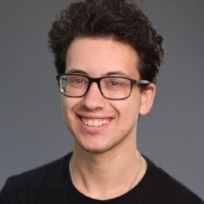

# Jacob Vider

Hi, I'm Jacob! (he/him/his) <h2> 
{fig-align="left" width=250}

Physicist and instrumentation engineer. I build and test optical, electronic, and software systems for telescopes, from lab prototypes to space-mission data pipelines.

Most recently I was a Research Assistant at NASA Goddard Space Flight Center, developing the data reduction pipeline for a space-based telescope. 
Before that, I spent two years in the astronomy instrumentation lab at the University of Arizona, where I led the near-UV upgrade of the Super-LOTIS telescope and wrote first-author work that I am now publishing. I have a dual BA/BSc in Physics and Applied Physics from [Clark University](https://www.clarku.edu/) and [Columbia University's School of Engineering and Applied Science (SEAS)](https://www.engineering.columbia.edu/home-eng).
Check out my [projects](projects.qmd) for more information.