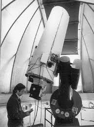

## Streaming Data Pipeline and Performance Optimization
*NASA Goddard Space Flight Center, 2025-2026*

A modular pipeline that automatically analyzes live data from an operational space telescope with 20+ years of observations. It handles data selection, matching against historical references, image analysis, and validation, and pulls meaningful signals out of noisy data. I found the performance bottlenecks and restructured the algorithms so the pipeline could keep up with long-running streaming datasets, and packaged it with Docker for wider use.

**Tools:** Python, Docker, Linux

---

## Remote Hardware Control and Automation System
*University of Arizona, Steward Observatory, 2023-2025*

I led a $100K NSF-funded hardware and software upgrade that turned an existing telescope into a remotely operated, robotic system. I wrote the software for camera control, environmental monitoring (pressure and temperature), and communication between components over a TCP/IP client-server architecture. I validated it against simulated hardware before deployment. On the hardware side, I installed instrumentation to stabilize the shutter, constrain camera motion, and monitor pressure. I also measured optical filter performance in the lab and built a Python model of the full system's throughput. I mentored an undergraduate on the team, and the work was presented at two international conferences ([SPIE 2024](https://doi.org/10.1117/12.3030767), AAS 2025). **First-author publication in prep.** 

{fig-align="left" width=250}

**Tools:** C/C++, Python, Bash, TCP/IP, optical testing

---

## Simulation Framework for Pipeline Validation
*University of Arizona, 2023-2024*

I built simulated observations for Aspera, a NASA-funded space telescope mission, and used them to test and refine its data reduction pipeline before launch.

**Tools:** Python, simulation

---

## Closed-Loop Motion Control
*New York Genome Center, 2023*

I helped repurpose a commercial DNA sequencing system into an automated fluorescence microscopy platform. I wrote reusable Python modules for instrument control and data acquisition, and implemented closed-loop PID control for automated positioning, validated by experiment. I also integrated the motion-control hardware, sensors, and data acquisition into one system, and wrote the technical documentation.

**Tools:** Python, PID control

---

## Optical Instrument Prototype
*Columbia University, 2022*

I designed, built, and tested a compact spectrograph from partly 3D-printed parts. We tested it with calibration lasers in a darkroom, went through several redesigns of a lenslet array to reduce optical distortion, and then validated it on a 14" telescope. It won first place for research presentation at Columbia AstroFest.

**Tools:** SolidWorks/CAD, 3D printing, optical alignment, laser testing

---

## Signal Detection in Noisy Time-Series Data
*Columbia University · 2022-2023*

I built statistical simulations to detect periodic signals in irregularly sampled, noisy time-series data, and compared the results against real observational data.

**Tools:** Python, astroML, statistical modeling

---

## Embedded Sensor Systems
*Clark University, 2020-2021*

I built Arduino and Raspberry Pi sensor and data-acquisition systems, including flowmeters and temperature sensors, for more than 25 experiments, and calibrated sensors and diagnosed electrical faults along the way. I also restored the hardware of a 3-meter radio telescope, working with vendors to source parts, and rewrote its control interface. I tested it by tracking the Moon.

**Tools:** Arduino, Raspberry Pi, C++, Python, Java

---

## Computer Vision: 3D Reconstruction from Images
*Tel Aviv University (remote), 2020*

I wrote computer-vision code that reconstructs 3D models from 150–200 images, and set up a home lab of cameras and automated, calibrated multi-angle image capture. A graduate student later used the code to model 3D flow in water.

**Tools:** MATLAB, computer vision, camera calibration